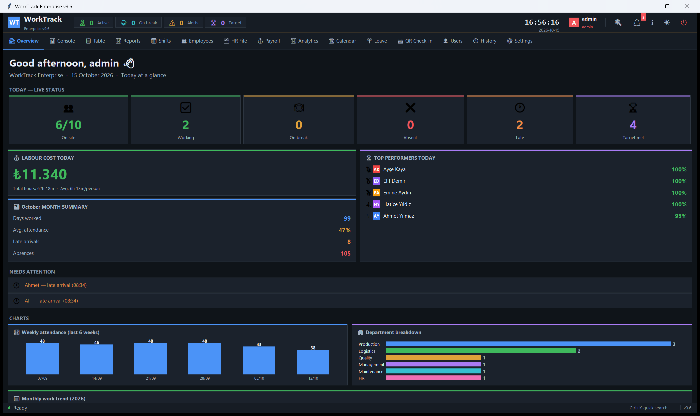
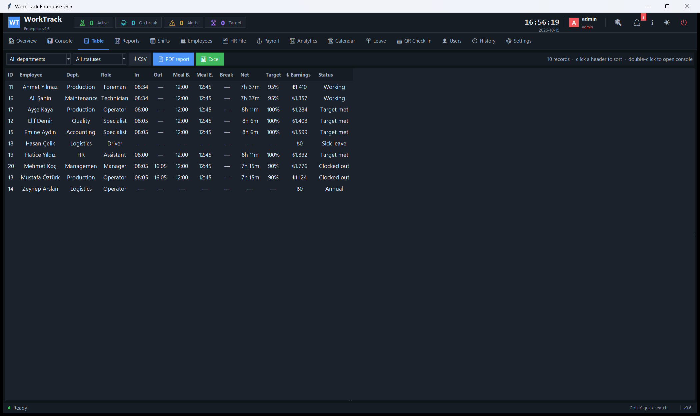
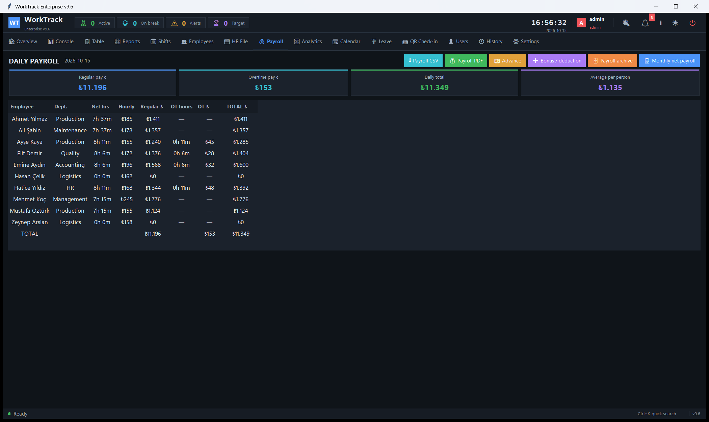
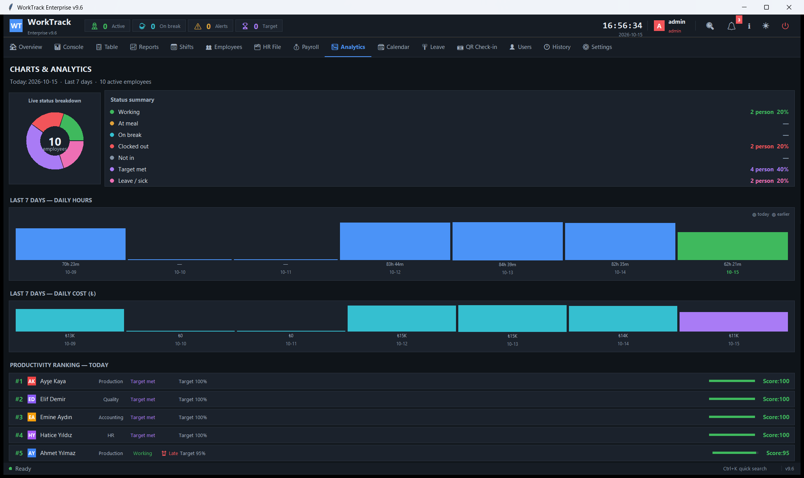
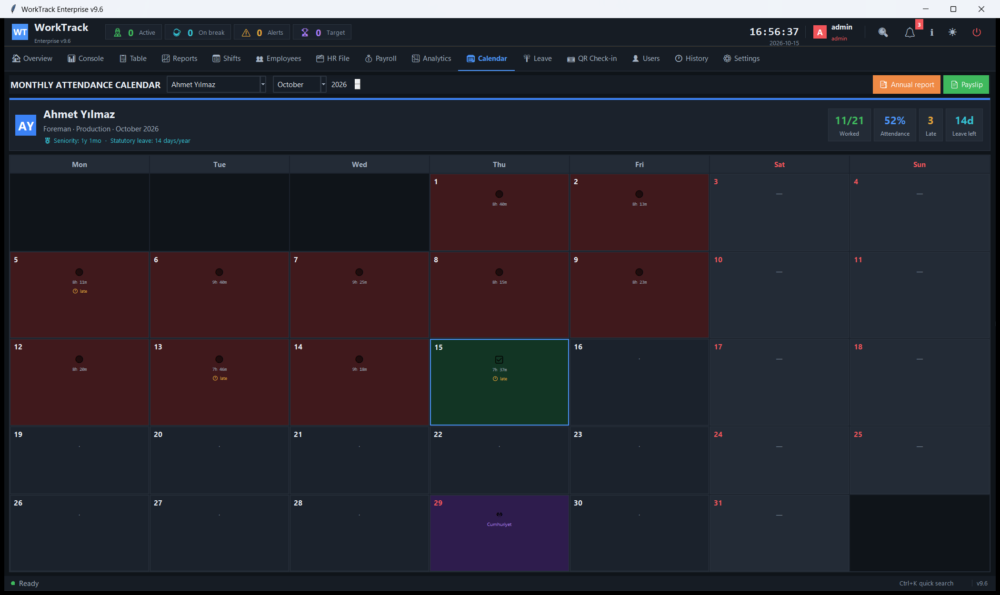
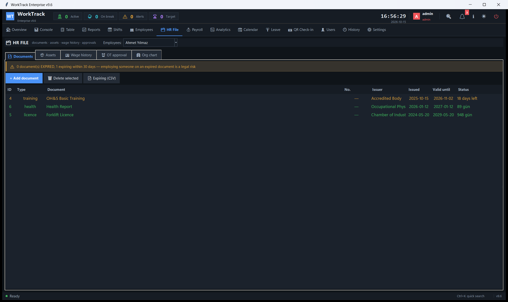
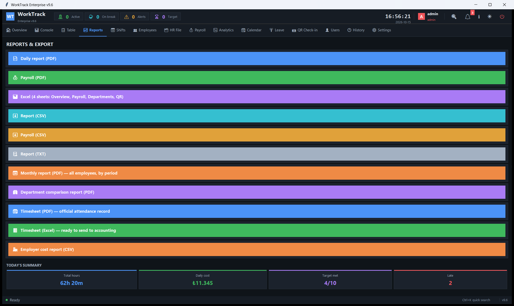
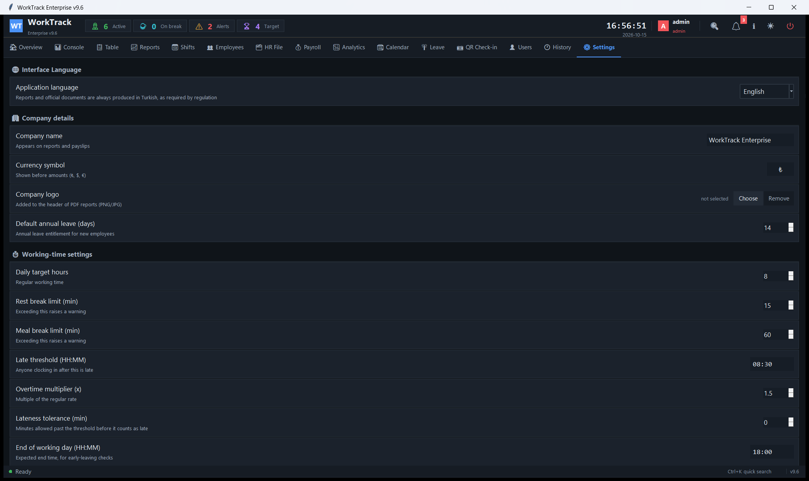

<div align="center">

# WorkTrack Enterprise

**Offline-first attendance tracking and payroll for small and mid-sized employers.**

No server. No cloud account. No subscription.
One Windows machine, one database file, one installer.

[Download](../../releases) · [Türkçe](README.tr.md)

</div>

---



## The problem it solves

Small manufacturers record hours on paper, then re-key them into a spreadsheet
at the end of the month to work out pay. The loop costs hours of admin time and
quietly produces wrong numbers — a missed late arrival here, a mistyped overtime
hour there, and the payslip is wrong before anyone checks it.

WorkTrack keeps the attendance record and **derives payroll from it**, so the
two can't drift apart.

## Attendance

Clock-in, clock-out, meal and rest breaks, per-person daily target, lateness
threshold with a tolerance window. Status is computed, not typed.



## Payroll, derived — not re-entered

Regular hours and overtime are separated automatically and priced at the
person's own rate. Monthly net pay applies progressive income tax brackets, the
minimum-wage exemption, social security and unemployment contributions, stamp
duty, and severance and notice pay with the statutory ceiling.



Every rate is editable in Settings — tax brackets, the minimum wage, employer
contribution percentages — because they change every year and your accountant,
not your software vendor, should have the final word on them.

## Analytics



## Monthly timesheet

Per person, per month: worked days, attendance rate, lateness, remaining leave,
and public holidays. Exports as the official timesheet PDF or Excel that
accounting expects.



## HR file

Documents with expiry tracking (an expired safety certificate is a legal risk,
so it is flagged before it expires), assigned assets, wage history, and an
overtime approval flow.



## Reports



## English or Turkish interface

The interface switches at runtime. **Generated documents stay Turkish** —
payslips and timesheets are filed with Turkish authorities, where an English
version has no legal standing.



---

## Install

Download the latest installer from the [Releases](../../releases) page and run it.

- Installed under Program Files, data is written to `%APPDATA%\WorkTrack`.
- The first user is `admin` / `1234`; the application will not let you continue
  until that password is changed.
- Without a licence it runs as a **30-day trial**.

> The installer is not yet code-signed, so Windows SmartScreen will show an
> "unknown publisher" warning on first run.

**Requirements:** 64-bit Windows; developed and tested on Windows 10 and 11.
No runtime to install, no database server, no internet connection.

## What it sends: nothing

The application touches the network in exactly one place — the update check —
and that check sends no data at all. It performs a single GET for a static file
(`surum.json`) in this repository and reads a version number from it.

There is no telemetry, no account, no licence call-home.

## How updates are trusted

An auto-updater is a remote code execution channel by definition, so trust is
placed in a **signature**, not in the transport:

```
signed manifest → version compare → your confirmation → download
               → SHA-256 checked against the hash inside the signed manifest
               → install
```

`surum.json` is signed with the vendor's private key and carries the SHA-256 of
the installer. The application verifies the signature, then verifies that the
file it downloaded matches that hash. **If the hash does not match, the file is
deleted rather than run.**

This means a compromised server cannot announce a fake version and cannot swap
the installer. HTTPS is a second layer here, not the foundation.

## Licence

Proprietary software, all rights reserved. Terms of use are in
`LISANS_SOZLESMESI.txt`, included with the installation.

Source code is not published in this repository.
